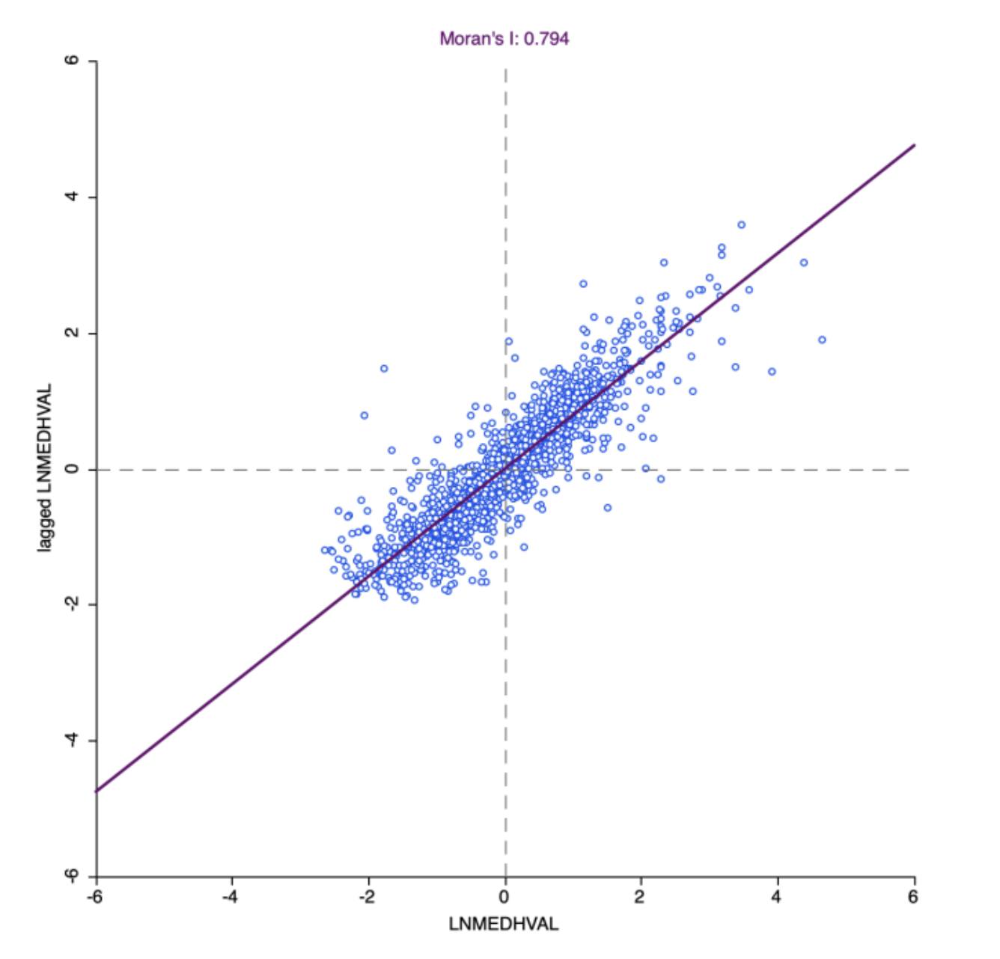
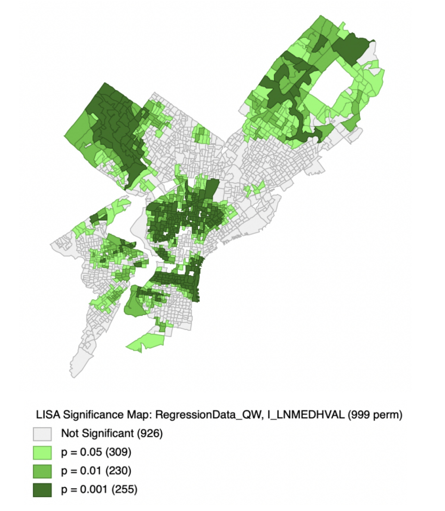
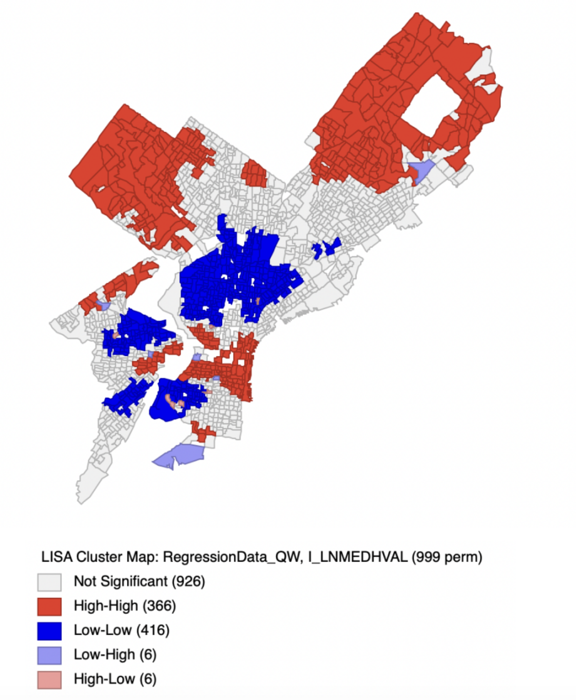
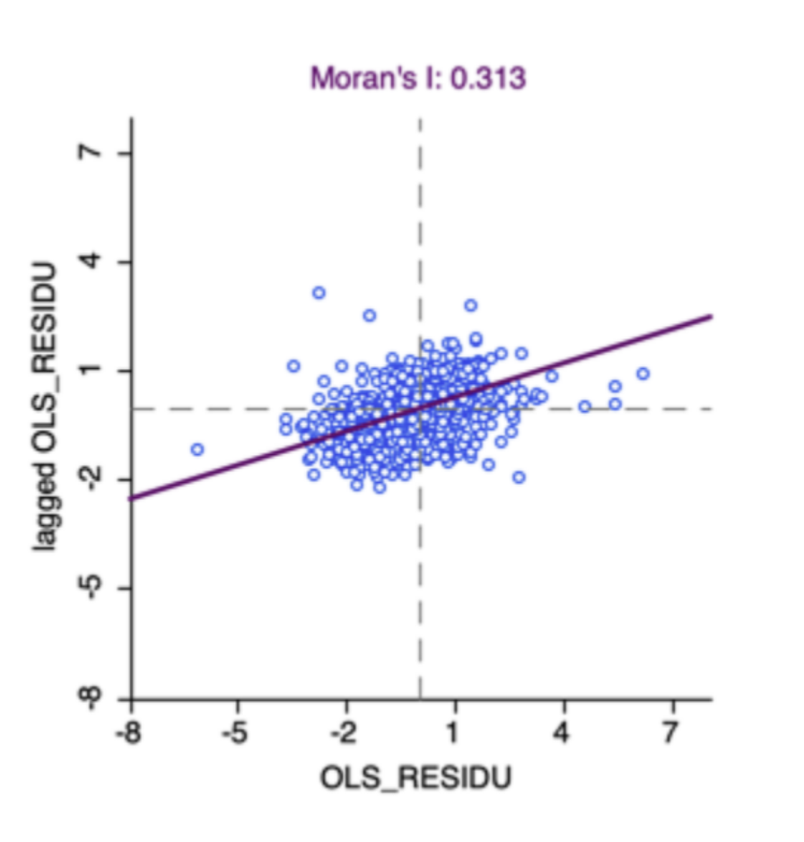
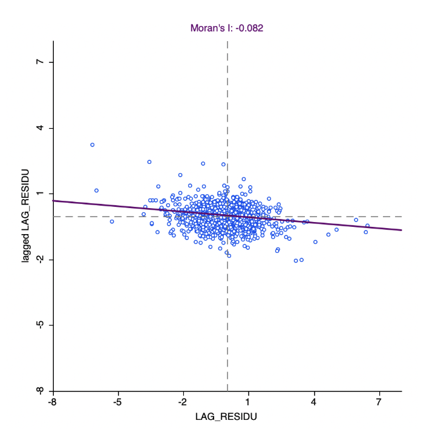
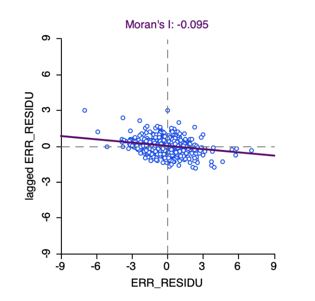
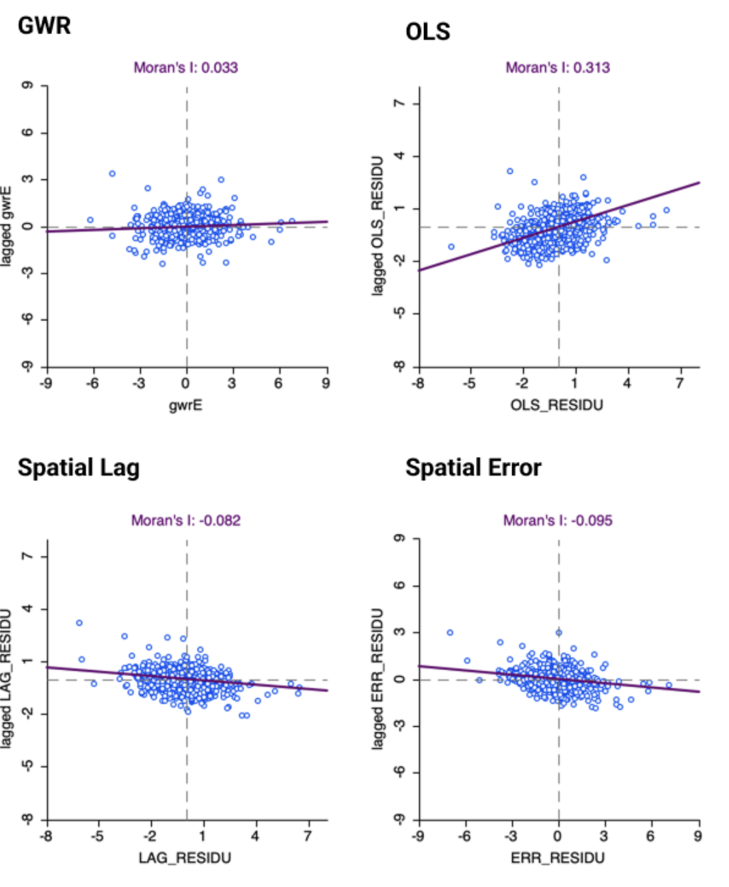
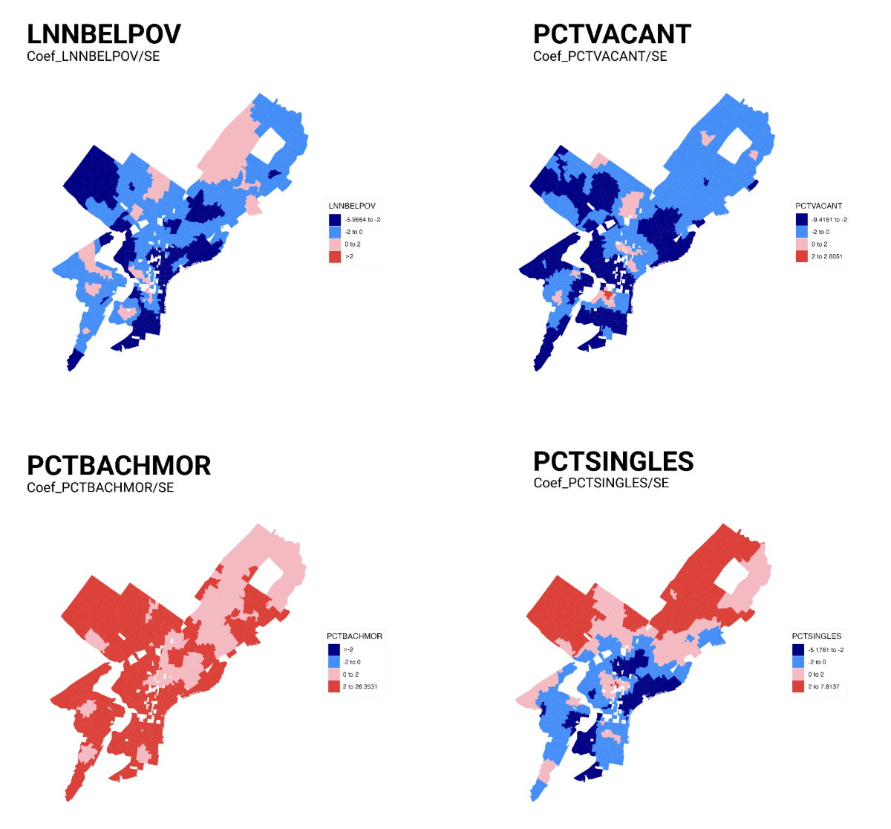
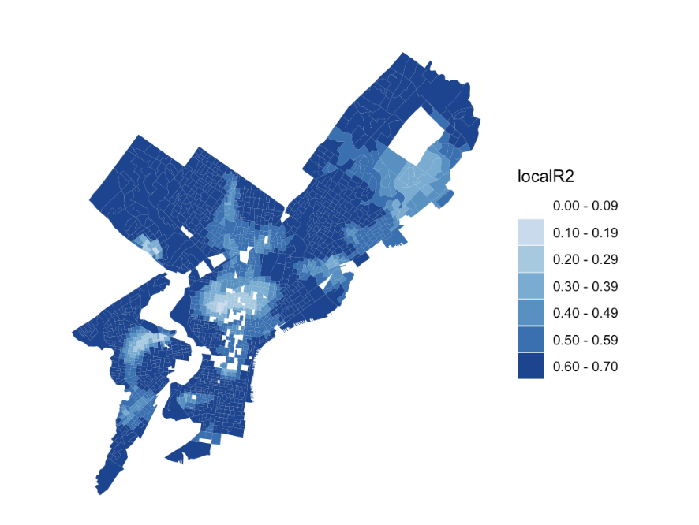

# Introduction

This project aims to predict the log of median house value in Philadelphia by block group through predictors including number of households below poverty, percent of people with a bachelor's degree or more, percent detached single-family units, and percent of vacant units. In Homework 1, we ran an Ordinary Least Squares (OLS) regression model on the same dependent variable and predictors.

OLS regression is often inappropriate when dealing with datasets that have a spatial component, such as the one we are working on. This is largely due to spatial data violating a core OLS assumption of independence of errors (i.e., spatial autocorrelation of residuals). The purpose of this report is to use Spatial Lag, Spatial Error, and Geographically Weighted Regression models to see whether these methods perform better than OLS.

# Methods & Results

## Spatial Autocorrelation

Spatial autocorrelation is the measure of how much a variable is related to values at nearby locations. More simply, it measures if similar values cluster next to each other. It's related to the First Law of Geography, which states that all things are related to each other, but nearer things are more related than distant things.

Moran's $I$ is used to measure spatial autocorrelation. The global Moran's $I$ (which measures spatial autocorrelation across the entire geographic area) can be calculated using this formula:

$$
I = \frac{n}{S_0} \cdot \frac{\sum_{i=1}^{n}\sum_{j=1}^{n} w_{ij}\, z_i z_j}{\sum_{i=1}^{n} z_i^2}
$$ {#eq-moran-global}

Where:

- $n$ = total number of features or spatial points
- $S_0$ = the sum of all spatial weights
- $z_i$ = the deviation of an attribute for feature $i$ from its mean ($x_i - \bar{X}$)
- $z_j$ = the deviation of an attribute for neighbor $j$ from its mean ($x_j - \bar{X}$)
- $w_{ij}$ = the spatial weight matrix value between features $i$ and $j$

The value of Moran's $I$ falls in between $-1$ and $1$.

- A value of $-1 \le I < 0$ indicates negative spatial autocorrelation. Similar values repel each other, and dissimilar values neighbor each other, creating a "checkerboard" pattern on the map.
- A value of $0 < I \le 1$ indicates positive spatial autocorrelation. Higher values are found next to higher values, and vice versa.
- A value of $0$ indicates that the attribute is randomly distributed across geographic space with neither clustering nor checkerboarding.

### The Spatial Weights Matrix

A weight matrix defines which geographic features are considered neighbors and how strongly each of those features are connected to each other. There are several different types of weight matrices. In this assignment, we used a queen weight matrix, which defines neighbors as a feature that shares any boundary segment or corner vertex. However, statisticians sometimes like to use multiple spatial weight matrices in their calculations to test if their results are robust. A neighbor that shares a long boundary vs. a neighbor that shares only a single spatial point (for example, in checkerboard-style property boundaries) will often have different characteristics and different levels of spatial autocorrelation. A queen weight matrix is helpful to capture all possible neighbors, but to verify the accuracy of the analysis, using other weight matrices can be useful as well.

To calculate the global Moran's $I$ for our variables with GeoDa, we first need to generate the weight matrix to determine how block groups are defined as neighbors to one another. Then, we can use the Moran's $I$ tool to calculate the Moran's $I$ for our variables.

To determine if the Moran's $I$ value is statistically significant, we use a random permutation test with 999 permutations. The null hypothesis $H_0$ is that there is no spatial autocorrelation; the alternate hypothesis $H_a$ is that spatial autocorrelation exists. GeoDa randomly rearranges the observed values and calculates a new Moran's $I$ for each permutation, creating a reference distribution. Then, we calculate the true Moran's $I$ and compare it against this reference distribution. If it falls in an extreme enough area in either tail of the distribution (where there is an extremely low probability of it actually occurring in the distribution), we reject the null hypothesis and conclude that spatial autocorrelation exists.

Local spatial autocorrelation measures how similar a specific point or feature is to its neighboring features. It is useful for determining hot or cold spots where high and low values cluster together. The output of a local spatial autocorrelation test can be divided into 4 quadrants:

- High values clustered near each other (HH)
- Low values found among high values (LH)
- High values found among low values (HL)
- Low values clustered near each other (LL)

The local Moran's $I$ (LISA) test evaluates the local spatial autocorrelation. LISA can be evaluated using this formula:

$$
I_i = \frac{x_i - \bar{x}}{s^2} \sum_{j} w_{ij}\,(x_j - \bar{x})
$$ {#eq-lisa}

Where:

- $x_i$ = the attribute value at location $i$
- $\bar{x}$ = the mean of the attribute across all features in the dataset
- $s^2$ = the variance of the attribute across all features
- $w_{ij}$ = the spatial weight matrix value between features $i$ and $j$
- $j$ = all neighboring features to location $i$

In our analysis, we use the same methodology as calculating the standard Moran's $I$ values, but choose the LISA option at the end.

LISA significance is tested using a permutation test, which compares the observed local spatial association for each location against a reference distribution generated by randomly rearranging neighboring values. A statistically significant result (typically $p < 0.05$) indicates that the location has a meaningful spatial relationship with its neighbors.

### Spatial Autocorrelation Results

Our first test is on the Moran's $I$ of the log-transformed median home values, our dependent variable.

{#fig-moran-lnmedhval width="255"}

With a Moran's $I$ of 0.794, we can observe strong spatial autocorrelation in the dependent variable; in this case, homes with high values tend to be clustered near to one another, and vice versa.

![Moran's $I$ significance test with 999 permutations (pseudo $p$-value = 0.001; $I$ = 0.7936, E\[$I$\] = -0.0006, mean = -0.0007, sd = 0.0138, $z$ = 57.5194)](figures/moran_lnmedhval_perm.png){#fig-moran-perm width="545"}

With 999 permutations, the actual value of the Moran's $I$ falls far outside of the expected distribution. With a pseudo $p$-value of 0.001, we can reject the null hypothesis in favor of the alternative hypothesis: the existence of spatial autocorrelation in our dependent variable.

Next, we can run our LISA (local Moran's $I$) tests:

{#fig-lisa-sig width="472"}

The LISA significance map identifies block groups where spatial autocorrelation is the most statistically significant. Note that highly significant areas could have purely high or purely low home values. The most significant pseudo $p$-values appear in the affluent areas of Center City and NW Philadelphia, and the poorer regions in North Philadelphia.

{#fig-lisa-cluster width="488"}

For this analysis, high-high block groups have high home values and are also surrounded by neighboring block groups with high values. These are located in the more affluent areas in the northwest, northeast, and central parts of the city.

Low-low block groups are the opposite: they have low home values and are surrounded by neighboring block groups with similarly low values.

High-low areas have high home values but are surrounded by areas of low home values. Low-high areas have low home values but are surrounded by areas of high home values. Due to the strong positive spatial autocorrelation of the dependent variable, both of these types occur much less frequently than high-high or low-low clusters.

There is also a fifth category: not significant. In this case, the block group does not exhibit statistically significant local spatial autocorrelation at a significance level of 0.05.

## OLS Regression & Assumptions

Ordinary least squares (OLS) regression finds a line of best fit through the data by minimizing squared residuals. It finds the optimal y-intercept and slope that passes through the data with the least squared error for each point.

OLS has several essential assumptions:

- **Linearity in parameters:** The model is linear in the coefficients, so the dependent variable is a linear function of the parameters plus an error term.
- **Random sampling:** The observations are drawn randomly from the population, so they are independent of one another.
- **No perfect multicollinearity:** No regressor is an exact linear combination of the others, which allows each coefficient to be uniquely estimated.
- **Homoskedasticity:** The error term has constant variance across all values of the regressors.
- **No autocorrelation:** The error terms are uncorrelated with one another across observations, spatially and temporally.
- **Normality of errors:** The errors are normally distributed.

However, when working with geographic data, the assumption that errors are random and independent often doesn't hold. You can test this assumption by examining the spatial autocorrelation of the residuals using Moran's $I$. Another way to test OLS residuals for spatial autocorrelation is to regress them on nearby residuals. This involves comparing `OLS_RESIDU` (the original OLS residuals) with `WT_RESIDU`, the spatially weighted residuals calculated with our Queen weights matrix. `slope_b` is the coefficient from regressing `OLS_RESIDU` on `WT_RESIDU`, testing the same thing as Moran's $I$: a positive value of `slope_b` indicates positive spatial autocorrelation, while a negative slope indicates negative spatial autocorrelation.

GeoDa also has ways of testing other regression assumptions. Homoscedasticity can be tested using the Breusch-Pagan Test. The null hypothesis is that the residuals are homoscedastic, and the alternative hypothesis is that the residuals are heteroscedastic. The normality of errors can be tested using the Jarque-Bera Test. The null hypothesis is that the residuals are normally distributed, and the alternative hypothesis is that the residuals are not normally distributed.

### OLS Regression Results

::: {#tbl-ols}
```         
REGRESSION
----------
SUMMARY OF OUTPUT: ORDINARY LEAST SQUARES ESTIMATION
Data set            :  RegressionData
Dependent Variable  :  LNMEDHVAL    Number of Observations:  1720
Mean dependent var  :   10.882      Number of Variables   :     5
S.D. dependent var  :  0.62972      Degrees of Freedom    :  1715

R-squared           :  0.662300     F-statistic           :  840.869
Adjusted R-squared  :  0.661513     Prob(F-statistic)     :        0
Sum squared residual:   230.332     Log likelihood        :  -711.493
Sigma-square        :  0.134304     Akaike info criterion :   1432.99
S.E. of regression  :  0.366475     Schwarz criterion     :   1460.24
Sigma-square ML     :  0.133914
S.E of regression ML:  0.365942

-----------------------------------------------------------------------------
    Variable     Coefficient     Std.Error     t-Statistic    Probability
-----------------------------------------------------------------------------
    CONSTANT         11.1138     0.0465318         238.843        0.00000
   LNNBELPOV      -0.0789035     0.0084567         -9.3303        0.00000
  PCTBACHMOR       0.0209095   0.000543184         38.4944        0.00000
   PCTVACANT      -0.0191563   0.000977851        -19.5902        0.00000
  PCTSINGLES      0.00297695   0.000703155         4.23371        0.00002
-----------------------------------------------------------------------------

REGRESSION DIAGNOSTICS
MULTICOLLINEARITY CONDITION NUMBER   12.990609

TEST ON NORMALITY OF ERRORS
TEST                 DF         VALUE           PROB
Jarque-Bera           2       778.9646        0.00000

DIAGNOSTICS FOR HETEROSKEDASTICITY
RANDOM COEFFICIENTS
TEST                 DF         VALUE           PROB
Breusch-Pagan test    4       162.9108        0.00000
Koenker-Bassett test  4        61.6992        0.00000

DIAGNOSTICS FOR SPATIAL DEPENDENCE
FOR WEIGHT MATRIX : RegressionData_QW
   (row-standardized weights)
TEST                 MI/DF       VALUE           PROB
Moran's I (error)    0.3129      22.3664        0.00000
Lagrange Multiplier (lag)     1     930.1626    0.00000
Robust LM (lag)               1     441.1061    0.00000
Lagrange Multiplier (error)   1     490.5691    0.00000
Robust LM (error)             1       1.5126    0.21875
Lagrange Multiplier (SARMA)   2     931.6751    0.00000
============================== END OF REPORT ================================
```

OLS output
:::

All four of our independent variables are statistically significant, with an $R^2$ value of 0.6623; for this model, we can expect approximately 66.23 percent of the variance in the data to be explained by these factors.

The coefficient of the Breusch-Pagan test is 162.9108, with a statistically significant $p$-value of 0.000. Therefore, we reject the null hypothesis that the error terms are homoscedastic in favor of the alternative hypothesis. The Koenker-Bassett test also gives a statistically significant $p$-value of 0.000, so both results are consistent with each other.

The statistic of the Jarque-Bera test for normality of errors is 778.9646, with a statistically significant $p$-value of 0.000. Therefore, we reject the null hypothesis that regression errors are normally distributed in favor of the alternative hypothesis.

Our statistical tests reveal a problem with heteroscedasticity in the data. However, in HW 1, based on a visual inspection of the residual plot, we determined the standard residuals to be homoscedastic.

The residual plot is the visual check for heteroscedasticity, and in HW 1 we judged it to be roughly constant in spread. The Breusch-Pagan (162.9) and Koenker-Bassett (61.7) tests both reject homoscedasticity ($p < 0.001$). With 1,720 observations these tests can detect mild differences in spread that are hard to see by eye, so the plot and the tests are not truly in conflict. The tests are the more reliable evidence, and they indicate a heteroscedasticity problem.

The histogram is the visual check for normality of the errors. In HW 1 we described the standardized residuals as roughly normal, with a slight left skew, but the Jarque-Bera test (778.96, $p < 0.001$) rejects normality. The histogram helps explain why: it is sharply peaked around zero, with heavier tails than a normal curve and a few extreme residuals beyond $\pm 4$. Jarque-Bera is sensitive to heavy tails and skewness, and with a sample this large it detects even moderate departures from normality. Non-normality matters less for the coefficient estimates when the sample is large, but it does affect the reliability of prediction intervals. The formal test is therefore a more reliable guide than the plot alone.

Next, we examine the relationship between `WT_RESIDU` and `OLS_RESIDU` to check for spatial autocorrelation.

{#fig-scatter-resid width="577"}

Our $p$-value of `slope_b` is 0.000, a statistically significant value that reveals significant spatial autocorrelation in the OLS residuals.

{#fig-moran-ols width="431"}

With a Moran's $I$ value of 0.313, we can observe moderate spatial autocorrelation in our OLS model. The positive value shows that similar values cluster together.

![Results from 999 permutations for OLS regression residuals (pseudo $p$-value = 0.001; $I$ = 0.3129, E\[$I$\] = -0.0006, mean = -0.0007, sd = 0.0136, $z$ = 23.1094)](figures/perm_ols_resid.png){#fig-perm-ols}

The results of the random permutation test gives us a pseudo $p$-value of 0.001, which confirms that the Moran's $I$ of 0.313 is statistically significant ($p < 0.05$). This is indeed problematic, as a key OLS assumption is the independence of errors. Therefore, we move to spatial regression models in the following sections.

The Moran's $I$ result and the $\beta$ coefficient of plotting `OLS_RESIDU` against `WT_RESIDU` tell a similar story. Both statistics are significant, and both point to the independence of errors assumption being violated.

## Spatial Lag & Spatial Error Regression

We used GeoDa for our Spatial Lag and Error Regression analyses.

### Spatial Lag Regression Methods

Spatial lag regression is a spatial regression model that takes into account spatial dependence in the dependent variable, an occurrence that violates the OLS assumption of independence of errors. This model includes the spatial lag of the dependent variable in the predictors. In other words, it assumes the dependent variable $y$ is associated with the values of $y$ in nearby locations.

What determines "nearby" is defined in the spatial weights matrix $W$, which is defined before calculating any spatial regression. For our model, we constructed a spatial weights matrix with queen contiguity, meaning block groups are counted as "neighbors" if they share a border or a vertex.

Our spatial lag model is as follows:

$$
\begin{aligned}
LNMEDHVAL_i ={}& \beta_0 + \rho\, W\,LNMEDHVAL_i + \beta_1\, LNNBELPOV_i + \beta_2\, PCTBACHMOR_i \\
& + \beta_3\, PCTSINGLES_i + \beta_4\, PCTVACANT_i + \epsilon_i
\end{aligned}
$$ {#eq-spatial-lag}

Where:

- $y$ = Log of median home value (`LNMEDHVAL`)
- $\rho$ = Spatial autoregressive coefficient. It measures the extent to which median home values in neighboring geographic areas influence median home values in a given area. A positive rho indicates that areas surrounded by neighborhoods with higher home values tend to have higher home values themselves, reflecting positive spatial dependence.
- $W\,LNMEDHVAL_i$ = Spatially lagged dependent variable
- $\beta_0$ = Intercept term
- $\beta_1, \beta_2, \beta_3, \beta_4$ = Coefficients for predictors `LNNBELPOV`, `PCTBACHMOR`, `PCTSINGLES`, and `PCTVACANT` respectively.
- $\epsilon$ = Error term. It represents the portion of median home values that is not explained by the spatial lag or the independent variables included in the model. It accounts for unobserved factors and random variation that may influence median home values.

### Spatial Error Regression Methods

The spatial error model, alternatively, assumes that the residual at one location is associated with residuals at nearby locations. Like the spatial lag model, it is also constructed using spatial weights matrix $W$. However, rather than accounting for spatial dependence in the dependent variable itself, the spatial error model accounts for spatial autocorrelation in the error terms. This suggests that unobserved factors influencing median home values in one geographic area may also affect neighboring areas. The spatial error coefficient $\lambda$ measures the strength of this spatial dependence, while the error term $u$ captures the unexplained variation in median home values that exhibits spatial patterns across neighboring locations.

Our spatial error model is as follows:

$$
LNMEDHVAL_i = \beta_0 + \beta_1\, LNNBELPOV_i + \beta_2\, PCTBACHMOR_i + \beta_3\, PCTSINGLES_i + \beta_4\, PCTVACANT_i + \epsilon_i
$$ {#eq-spatial-error-mean}

$$
\epsilon = \lambda W \epsilon + u
$$ {#eq-spatial-error-term}

Where:

- $\beta_0$ = Intercept term
- $\beta_1, \beta_2, \beta_3, \beta_4$ = Coefficients for predictors `LNNBELPOV`, `PCTBACHMOR`, `PCTSINGLES`, and `PCTVACANT` respectively.
- $\lambda$ = Spatial error coefficient, which measures the degree of spatial dependence in the model's error terms. A positive lambda indicates that unobserved factors affecting median home values in one geographic area may also affect neighboring areas.
- $u$ = Random error term. It represents unexplained variation in median home values that is not accounted for by the independent variables in the model. It captures random influences and unobserved factors, while the spatial error component accounts for the possibility that these unexplained influences are correlated across neighboring geographic areas.
- $\epsilon$ = Spatially correlated error term. It represents the combined unexplained variation in median home values, accounting for both random error and spatially correlated influences from neighboring geographic areas.

Even though spatial regression aims to correct the violation of independence of errors, it still requires a few remaining OLS assumptions. These include each predictor having a linear relationship with the dependent variable, normality of residuals, no heteroscedasticity, and the absence of multicollinearity.

The goal of spatial regression is to take into account the possibility of spatial dependency in the data or the model's residuals. After running spatial lag or spatial error, residuals may be no longer spatially autocorrelated or less heteroscedastic.

We compared the results of spatial lag regression with OLS and the results of spatial error regression with OLS, and decide the proper model to use based on the following criteria:

**1. Akaike Information Criterion (AIC) / Schwarz (Bayesian) Information Criterion (BIC/SIC)**

AIC and BIC are model-selection measures that reward goodness of fit (via the log likelihood) but penalize the number of parameters:

$$
AIC = -2\log(L) + 2k
$$ {#eq-aic}

where $k$ is the number of parameters and $n$ is the sample size. The formula for BIC is as follows:

$$
BIC = -2\log(L) + k \cdot \ln(n)
$$ {#eq-bic}

You choose the model with the lower AIC or BIC value, and BIC penalizes complexity more heavily than AIC when $n$ is large ($n > 7$). Unlike the likelihood ratio test, they can compare non-nested models and don't require a formal hypothesis test.

**2. Log likelihood**

The log likelihood measures how well a model's estimated parameters explain the observed data, with values closer to zero (less negative) or simply larger indicating a better fit. Because adding parameters will never decrease the log likelihood, you can't pick the model with the higher value alone when the models differ in complexity. It is only a fair comparison between models with the same number of parameters, and it is the building block for AIC, BIC, and the likelihood ratio test.

**3. Likelihood ratio test (LRT)**

The LRT compares two nested models (a simpler "reduced" model and a more complex "full" model) using the statistic

$$
LR = -2\left(\log L_{reduced} - \log L_{full}\right)
$$ {#eq-lrt}

which follows a $\chi^2$ distribution with degrees of freedom equal to the difference in the number of parameters. The null hypothesis ($H_0$) is that the reduced model fits the data as well as the full model (the extra parameters equal zero), and the alternative ($H_a$) is that the full model fits significantly better. If the $p$-value is less than your significance level (e.g., 0.05), you reject $H_0$ and prefer the full model; otherwise you keep the simpler model.

Another way of comparing OLS results with spatial lag and spatial error results is by looking at the Moran's $I$ of regression residuals. Based on this criterion, we decide the best model through finding which model has the closest $I$ value to 0 (i.e., the model with the lowest residual spatial autocorrelation).

### Spatial Lag Results

::: {#tbl-lag-output}
```         
>>10/29/2026 01:59:48 PM
REGRESSION
----------
SUMMARY OF OUTPUT: SPATIAL LAG MODEL - MAXIMUM LIKELIHOOD ESTIMATION
Data set            :  RegressionData
Spatial Weight      :  Queen_w
Dependent Variable  :  LNMEDHVAL    Number of Observations:  1720
Mean dependent var  :   10.882      Number of Variables   :     6
S.D. dependent var  :  0.62972      Degrees of Freedom    :  1714
Lag coeff. (Rho)    :  0.651097

R-squared           :  0.818564     Log likelihood        :  -255.74
Sq. Correlation     :  -            Akaike info criterion :   523.48
Sigma-square        :  0.071948     Schwarz criterion     :   556.18
S.E of regression   :  0.268231

-----------------------------------------------------------------------------
    Variable     Coefficient     Std.Error      z-value     Probability
-----------------------------------------------------------------------------
  W_LNMEDHVAL       0.651097     0.0180501      36.0716        0.00000
     CONSTANT        3.89846      0.201114      19.3843        0.00000
    LNNBELPOV     -0.0340547    0.00629287     -5.41163        0.00000
   PCTBACHMOR     0.00851381   0.000521935       16.312        0.00000
   PCTSINGLES     0.00203342    0.00051577       3.9425        0.00008
    PCTVACANT      -0.0085294   0.000743667     -11.4694        0.00000
-----------------------------------------------------------------------------

REGRESSION DIAGNOSTICS
DIAGNOSTICS FOR HETEROSKEDASTICITY
RANDOM COEFFICIENTS
TEST                 DF         VALUE           PROB
Breusch-Pagan test    4       220.3884        0.00000

DIAGNOSTICS FOR SPATIAL DEPENDENCE
SPATIAL LAG DEPENDENCE FOR WEIGHT MATRIX : Queen_w
TEST                 DF         VALUE           PROB
Likelihood Ratio Test 1       911.5067        0.00000
```

Spatial lag regression output
:::

| Statistic                     | OLS Model | Spatial Lag Model |
|-------------------------------|----------:|------------------:|
| Akaike information criterion  |   1432.99 |            523.48 |
| Schwarz information criterion |   1460.24 |            556.18 |
| Log likelihood                |  -711.493 |           -255.74 |
| Likelihood ratio test         |        \- |          911.5067 |

: Comparison of Spatial Lag and OLS

The lag coefficient $\rho$ is 0.651, so the `W_LNMEDHVAL` term is highly significant. It is positive and fairly large: a block group's median house value is highly tied to the median house value of its neighbors, even after controlling for the four predictors.

As seen in @tbl-lag-output, all predictors are significant, as with our OLS model.

The Breusch-Pagan statistic is significant ($p < 0.001$), so we reject homoskedasticity in the model. The lag residuals are therefore still heteroskedastic.

Comparing the OLS and Spatial Lag models (@tbl-lag-vs-ols), the Spatial Lag model has a lower, and therefore better, AIC (\~523 vs \~1433). This is the same with the Schwarz criterion (\~556 vs. \~1460). The log likelihood for the Spatial Lag model is better as well, as it is much higher (\~-256 vs. \~-711). Finally, the likelihood ratio test shows that $\rho$ is significantly different from zero ($p < 0.001$), so the Spatial Lag model is a significant improvement over OLS.

{#fig-moran-lag width="391"}

![Histogram of 999 permutations for spatial lag residuals (pseudo $p$-value = 0.001; $I$ = -0.0824, E\[$I$\] = -0.0006, mean = -0.0004, sd = 0.0140, $z$ = -5.8778)](figures/perm_lag_resid.png){#fig-perm-lag width="408"}

The Moran's $I$ of residuals for the Spatial Lag model is -0.082, a significant improvement over the Moran's $I$ of 0.313 of the OLS model residuals, meaning there is less spatial autocorrelation in the Spatial Lag residuals than those of OLS. Based on the histogram of 999 permutations, our pseudo $p$-value was significant ($p = 0.001$).

Overall, the Spatial Lag model clearly outperforms OLS on every criterion, though heteroskedasticity of residuals remains.

### Spatial Error Results

::: {#tbl-error-output}
```         
>>10/29/2026 02:05:15 PM
REGRESSION
----------
SUMMARY OF OUTPUT: SPATIAL ERROR MODEL - MAXIMUM LIKELIHOOD ESTIMATION
Data set            :  RegressionData
Spatial Weight      :  Queen_w
Dependent Variable  :  LNMEDHVAL    Number of Observations:  1720
Mean dependent var  :  10.882000    Number of Variables   :     5
S.D. dependent var  :  0.629720     Degrees of Freedom    :  1715
Lag coeff. (Lambda) :  0.814918

R-squared           :  0.806957     R-squared (BUSE)      :  -
Sq. Correlation     :  -            Log likelihood        :  -372.690368
Sigma-square        :  0.0765508    Akaike info criterion :  755.381
S.E of regression   :  0.276678     Schwarz criterion     :  782.631

-----------------------------------------------------------------------------
    Variable     Coefficient     Std.Error      z-value     Probability
-----------------------------------------------------------------------------
     CONSTANT         10.9064     0.0534678       203.981        0.00000
    LNNBELPOV      -0.0345341    0.00708933      -4.87127        0.00000
   PCTBACHMOR      0.00981293    0.000728964       13.4615        0.00000
   PCTSINGLES      0.00267792    0.000620832       4.31343        0.00002
    PCTVACANT     -0.00578308    0.000886701      -6.52201        0.00000
       LAMBDA        0.814918       0.016373       49.7719        0.00000
-----------------------------------------------------------------------------

REGRESSION DIAGNOSTICS
DIAGNOSTICS FOR HETEROSKEDASTICITY
RANDOM COEFFICIENTS
TEST                 DF         VALUE           PROB
Breusch-Pagan test    4       210.9923        0.00000

DIAGNOSTICS FOR SPATIAL DEPENDENCE
SPATIAL ERROR DEPENDENCE FOR WEIGHT MATRIX : Queen_w
TEST                 DF         VALUE           PROB
Likelihood Ratio Test 1       677.6059        0.00000
```

Spatial error regression output
:::

| Statistic                     | OLS Model | Spatial Error Model |
|-------------------------------|----------:|--------------------:|
| Akaike information criterion  |   1432.99 |             755.381 |
| Schwarz information criterion |   1460.24 |             782.631 |
| Log likelihood                |  -711.493 |         -372.690368 |
| Likelihood ratio test         |        \- |            677.6059 |

: Comparison of Spatial Error and OLS

The `LAMBDA` term $\lambda$ is 0.815 with a highly significant ($p < 0.001$) $z$-score of 49.77. It is positive and large, meaning that the error terms are strongly spatially autocorrelated. Unmeasured factors affecting house values, such as neighborhood amenities or school quality, are spatially clustered and not captured by the four predictors.

As seen in @tbl-error-output, all predictors are significant, as with our OLS model.

The Breusch-Pagan test for the Spatial Error Model is \~210 and highly significant ($p < 0.001$) with 4 degrees of freedom. This result indicates that the residuals of the model are still heteroscedastic.

{#fig-moran-error width="364"}

![Histogram of 999 permutations for spatial error residuals (pseudo $p$-value = 0.001; $I$ = -0.0945, E\[$I$\] = -0.0006, mean = -0.0003, sd = 0.0142, $z$ = -6.6546)](figures/perm_error_resid.png){#fig-perm-error width="464"}

The Moran's $I$ scatterplot shows a Moran's $I$ value of -0.095, indicating that there is much lower spatial autocorrelation in the Spatial Error model's residuals than the residuals of the OLS model, whose residuals had a Moran's $I$ value of 0.313. Our pseudo $p$-value based on the histogram of 999 permutations was significant as well ($p = 0.001$).

Based on all criteria listed, the Spatial Error model clearly beats the OLS model. However, as with the Spatial Lag model, there is still heteroscedasticity in the residuals.

### Comparison of Spatial Lag and Spatial Error Regression Models

| Statistic                    | Spatial Lag Model | Spatial Error Model |
|------------------------------|------------------:|--------------------:|
| Akaike information criterion |            523.48 |             755.381 |
| Schwarz criterion            |            556.18 |              782.63 |

: Comparison of Spatial Lag and Spatial Error Models

In comparing the Spatial Lag and Spatial Error models, the Likelihood Ratio test should not be used as the models are not nested. The AIC and Schwarz criterion can be compared instead. As seen in @tbl-lag-vs-error, the Spatial Lag model by far has lower values for both criteria.

The Spatial Lag model additionally has a Moran's $I$ value closer to zero for its residuals than the Spatial Error model, another metric where Lag beats Error.

## Geographically Weighted Regression

### GWR Methods

Geographically Weighted Regression (GWR) is a method of regression that addresses the limitation of spatial stationarity as an assumption in OLS regression. We ran GWR in R. In the OLS methods discussed above, the relationships modeled are assumed to be constant across space. In reality, however, relationships between variables often differ across space, thus resulting in the possibility of global regression results differing from local regression results. This is what Simpson's Paradox describes, in which a trend may appear in several groups of data when assessed separately, but disappears or reverses when assessed as a collective. GWR takes this into account by allowing relationships between dependent and explanatory variables to vary across space. The equation for GWR is as follows:

$$
y_i = \beta_{i0} + \beta_{i1} x_{i1} + \beta_{i2} x_{i2} + \cdots + \beta_{im} x_{im} + \epsilon_i
    = \beta_{i0} + \sum_{k=1}^{m} \beta_{ik} x_{ik} + \epsilon_i
$$ {#eq-gwr}

Where:

- $y_i$ = the dependent variable at the geographical location $i$
- $\beta_{i0}$ = the intercept parameter at location $i$
- $\beta_{ik}$ = the local regression coefficient for the $k$-th independent variable at location $i$
- $x_{ik}$ = the value of the $k$-th independent variable at location $i$
- $\epsilon_i$ = the residual term at location $i$
- $m$ = the total number of independent variables being used in the model

The equation extends traditional linear regression by allowing both the intercept and the regression coefficients to vary for each location-based observation $i = 1 \ldots n$ (where $n$ is the total number of geographical locations in the dataset), thus capturing how relationships between variables change across space.

To run local regression, a separate weighted least squares regression is fit for each location $i$. Observations close to location $i$ receive greater weights and have a stronger influence on its estimates. The weights come from a kernel function that declines with distance, controlled by the bandwidth, which determines how far the "local" neighborhood extends. A fixed bandwidth uses the same distance at every location. An adaptive bandwidth instead uses the distance to the $k$-th nearest neighbor, so it shrinks where observations are dense and expands where they are sparse, while every local regression uses the same number of observations. We used an adaptive bandwidth because Philadelphia's block groups are small and tightly packed in dense areas such as Center City and North and South Philadelphia, and larger and farther apart in areas such as the Northeast. A fixed distance would include many block groups in the dense core and only a few at the edge of the city, over-smoothing some estimates and making others unstable. The number of neighbors was selected automatically in R by minimizing a cross-validation score.

Many of the OLS assumptions still hold in GWR, including linearity, independence of errors, normality of residuals, homoscedasticity, and no multicollinearity. Multicollinearity needs particular care in GWR. Because each local regression uses only a small subset of observations, two or more predictors with similar clustered patterns in a region can cause local multicollinearity even when global multicollinearity is not present, which makes local coefficients unstable. The condition number of each local regression indicates when this is a problem, and a value larger than 30 is usually considered unreliable.

### GWR Results

::: {#tbl-gwr}
```         
gwr(formula = LNMEDHVAL ~ LNNBELPOV + PCTVACANT + PCTBACHMOR +
    PCTSINGLES, data = shps, gweight = gwr.Gauss, adapt = bw,
    hatmatrix = TRUE, se.fit = TRUE)
Kernel function: gwr.Gauss
Adaptive quantile: 0.008130619 (about 13 of 1720 data points)
Summary of GWR coefficient estimates at data points:
                   Min.     1st Qu.      Median     3rd Qu.        Max.  Global
X.Intercept.  9.6727618  10.7143173  10.9542384  11.1742009  12.0831381 11.1138
LNNBELPOV    -0.2365244  -0.0733572  -0.0401186  -0.0126657   0.0948768 -0.0789
PCTVACANT    -0.0317407  -0.0142383  -0.0089599  -0.0035770   0.0167916 -0.0192
PCTBACHMOR    0.0010974   0.0101380   0.0149279   0.0202187   0.0347258  0.0209
PCTSINGLES   -0.0249706  -0.0075550  -0.0016626   0.0042280   0.0143340  0.0030

Number of data points: 1720
Effective number of parameters (residual: 2traceS - traceS'S): 360.5225
Effective degrees of freedom (residual: 2traceS - traceS'S): 1359.477
Sigma (residual: 2traceS - traceS'S): 0.2762201
Effective number of parameters (model: traceS): 257.9061
Effective degrees of freedom (model: traceS): 1462.094
Sigma (model: traceS): 0.2663506
Sigma (ML): 0.245571
AICc (GWR p. 61, eq 2.33; p. 96, eq. 4.21): 660.7924
AIC (GWR p. 96, eq. 4.22): 308.7123
Residual sum of squares: 103.7248
Quasi-global R2: 0.8479244
```

GWR results
:::

| Regression    |     $R^2$ |
|---------------|----------:|
| GWR (overall) | 0.8479244 |
| OLS           |  0.662300 |
| Spatial Lag   |  0.818564 |
| Spatial Error |  0.806957 |

: Regression results comparison

@tbl-r2 compares the $R^2$ results from the four different regressions. With an $R^2$ of 0.8479, GWR is doing the best job of explaining the variance in the dependent variable. It explains roughly 84.8% of the variance, which is a significant improvement over the OLS that explains only around 66.2% of the variance. While the Spatial Lag (81.9%) and the Spatial Error (80.7%) also improve the OLS dramatically, the GWR still outperforms them with a better fit.

| Regression    | Akaike Information Criterion |
|---------------|-----------------------------:|
| GWR           |                     308.7123 |
| OLS           |                      1432.99 |
| Spatial Lag   |                       523.48 |
| Spatial Error |                      755.381 |

: AIC comparison

@tbl-aic compares the Akaike Information Criterion (AIC) across the different models. The AIC from the GWR (308.71) is significantly lower than the three other models, with OLS at 1432.99, Spatial Lag at 523.48, and Spatial Error at 755.38. As a lower AIC is better, the GWR model is the better model.

{#fig-moran-all width="595"}

Comparing the GWR residuals to the OLS residuals, the GWR Moran's $I$ of 0.033 is closer to 0 than the OLS Moran's $I$ of 0.313. This demonstrates that small but statistically significant positive autocorrelation remains in the GWR model as compared to the high, positive spatial autocorrelation in the OLS model. When compared to the Spatial Lag and Spatial Error models with Moran's $I$ values of -0.082 and -0.095, respectively, the slight negative spatial autocorrelation is improved upon in the GWR model.

![Histogram of 999 permutations for GWR residuals (pseudo $p$-value = 0.009; $I$ = 0.0334, E\[$I$\] = -0.0006, mean = -0.0006, sd = 0.0142, $z$ = 2.4015)](figures/perm_gwr_resid.png){#fig-perm-gwr width="446"}

Looking at our histogram, we can see that the Moran's $I$ value of 0.033 is statistically significant, with a significant pseudo $p$-value of 0.009 ($p < 0.05$).

{#fig-local-coefs}

@fig-local-coefs plots the local regression results of the four coefficients divided by the standard error. For all four plots, dark blue represents values below -2 that are possibly significant. Light blue represents values between -2 and 0 that are probably not significant. Similarly, light pink represents values between 0 and 2 that are probably not significant, and dark red represents values above 2 that are possibly significant.

For the variable `LNNBELPOV`, the results are mixed, with most of the central, west, northwest, and northeast being largely insignificant. The results are only significant in the borders of the northwest region, some pockets in the northeast, and a belt along the eastern side of central and south Philadelphia.

For the variable `PCTVACANT`, the results show stronger regional clustering in pockets of the northwest, lower northeast, west, and south (represented by the dark blue that demonstrate a significant negative relationship). There is also a small area within center city that demonstrates a significant positive relationship illustrated by the dark red. The northeast region shows a largely insignificant relationship between `PCTVACANT` and `LNMEDHVAL`.

For the variable `PCTBACHMOR`, the results demonstrate a relatively stationary, consistent relationship. With a predominantly dark red (values \> 2) spread across the city, the results indicate that the variable is possibly significant globally and exhibits little regional variation to inform region-wide policy.

For the variable `PCTSINGLES`, the results demonstrate significant spatial non-stationarity. The northwest and northeast regions have a possibly significant positive relationship illustrated by the dark red, while the central west, north, and parts of the lower northeast exhibit a possibly significant negative relationship. As such, the results from this variable inform targeted local policy instead of global ones.

### Local $R^2$ Map

{#fig-local-r2}

The local $R^2$ measures the goodness of fit of the regression model at each specific location. @fig-local-r2 plots this, illustrating how the model provides a moderately strong fit for the vast majority of block groups in Philadelphia as represented by the dark blue (0.60-0.70). However, there are prominent clusters in Center City and Northeast Philadelphia where the fit is poor, ranging around 0.09 to 0.39. This suggests that there are explanatory variables specific to that region that are still missing from the model.

# Discussion

This project took the house price dataset used in Homework 1, where OLS regression showed significant spatial autocorrelation in the residuals (Moran's $I$ = 0.313), and ran three spatial regression models: Spatial Lag, Spatial Error, and Geographically Weighted Regression (GWR). We compared each against OLS to see whether accounting for space improved the model.

Based on our findings, the GWR model was the best at predicting house prices, followed by Spatial Lag, Spatial Error, and then OLS. This conclusion is based on three criteria. First, the $R^2$ was the highest for GWR, with about 85% of the variance explained (compared to about 66% for OLS and about 82% and 81% for Spatial Lag and Spatial Error). Second, the Akaike information criterion was the lowest for GWR, at about 308 (compared to about 1432 for OLS, 523 for Spatial Lag, and 755 for Spatial Error). Third, the spatial autocorrelation of residuals was lowest for GWR, with a Moran's $I$ of 0.03 (about one-tenth the 0.313 of OLS). The Spatial Lag and Spatial Error residuals had Moran's $I$ values of $-0.082$ and $-0.095$, much smaller than OLS but still significantly negative, which suggests slight over-correction. Between the two, Spatial Lag was better on AIC, Schwarz criterion, and residual Moran's $I$. The local results also showed that the relationships between the predictors and house values vary across the city, which a single global model cannot capture. GWR's advantage should be read with caution, however. It estimates many more effective parameters (about 360), so part of its fit comes from flexibility, and its AICc (about 661) is higher than the Spatial Lag AIC. The Spatial Lag and Spatial Error $R^2$ values are also pseudo-$R^2$ values, not strictly comparable to OLS and GWR.

Our analysis has some limitations. The assumption of homoscedasticity was not met, as the Breusch-Pagan tests were statistically significant for the OLS, Spatial Lag, and Spatial Error models, and the Jarque-Bera test showed non-normal OLS residuals. Since these assumptions were violated, the standard errors of our coefficients may be biased, which leads to unreliable hypothesis tests. We also did not check local multicollinearity (condition numbers) for the GWR models. In addition, our models include only four independent variables, while housing values are influenced by many other factors, such as crime rates, architecture styles, and proximity to universities such as Penn. This could explain why the local $R^2$ values are lower in parts of Center City and the Northeast. Finally, we only used a Queen weights matrix and a single adaptive kernel, so other weight matrices or bandwidths could perform differently.

One final concept we were asked to explain is the difference between spatially lagged and spatial lag model residuals. Weighted (spatially lagged) residuals are the residuals of neighboring observations combined using the spatial weights matrix. For example, if a block group has neighboring residuals of 0.2, 0.4, and 0.6, its spatially lagged residual would be 0.4, given equal weights. Spatial lag model residuals, on the other hand, are the actual prediction errors of the spatial lag model, calculated by subtracting the model's predicted value from the observed value of the dependent variable. Weighted residuals are therefore a transformation of existing residuals, while spatial lag model residuals are generated by a regression model.